# Knock — Funciones, flujos de uso y qué necesita la versión real

Este documento describe **todo lo que hace la maqueta hoy**, cómo se usa paso a paso (con diagramas) y **qué hace falta para convertirlo en un producto real**: proveedores, servicios y decisiones pendientes.

> 🆕 **Decisiones del equipo (octubre 2026):** los bloques marcados **🆕 Decisión del MVP** reflejan lo ya decidido y **mandan sobre lo descrito como «versión real»**. El detalle completo está en [`DECISIONES.md`](DECISIONES.md#-decisiones-cerradas-octubre-2026).

> **Cómo leerlo**
> - ✅ **En la maqueta** = existe y se puede probar, pero casi siempre **simulado** (no hay servidor ni base de datos; los datos viven en el navegador).
> - 🔧 **En la versión real** = lo que se necesita construir o contratar.
> - Los diagramas usan [Mermaid](https://mermaid.js.org/): se ven directo en GitHub y en la vista previa de VS Code (con la extensión «Markdown Preview Mermaid Support»).

---

## Índice

1. [Qué es Knock](#1-qué-es-knock)
2. [Roles y mapa de pantallas](#2-roles-y-mapa-de-pantallas)
3. [Flujos del cliente](#3-flujos-del-cliente)
   - 3.1 Entrar sin cuenta (explorar)
   - 3.2 Registro e inicio de sesión
   - 3.3 Zona (ubicación o código postal)
   - 3.4 Buscar un experto (mapa, búsqueda, asistente)
   - 3.5 Pedir cotización
   - 3.6 Comparar, elegir y la visita
   - 3.7 Terminar, calificar, reportar y bloquear
   - 3.8 Actividad y mensajes
   - 3.9 Explorar
   - 3.10 Mi cuenta (datos, casa y auto, confianza, avisos, privacidad, ayuda)
   - 3.11 Cerrar sesión y eliminar cuenta
4. [Flujos del técnico](#4-flujos-del-técnico)
   - 4.1 Registro como técnico
   - 4.2 Verificación de identidad (INE + selfie)
   - 4.3 Pestaña Trabajo
   - 4.4 Chat, resumen con IA y cotización con IA
   - 4.5 Aceptación, visita, código y terminar el trabajo
   - 4.6 Reputación y perfil público
   - 4.7 Capa «Mi agenda» del mapa
5. [Estados de las entidades](#5-estados-de-las-entidades)
6. [Modelo de datos (conceptual)](#6-modelo-de-datos-conceptual)
7. [Qué necesita la versión real](#7-qué-necesita-la-versión-real)
   - 7.1 Arquitectura general
   - 7.2 Proveedores y servicios por función
   - 7.3 Verificación de identidad (INE) a fondo
   - 7.4 Legal, privacidad y tiendas de apps
   - 7.5 Seguridad y antifraude
8. [Qué es simulado en la maqueta](#8-qué-es-simulado-en-la-maqueta)
9. [Cómo probar la maqueta (datos y atajos de demo)](#9-cómo-probar-la-maqueta-datos-y-atajos-de-demo)
10. [Decisiones y pendientes](#10-decisiones-y-pendientes)

---

## 1. Qué es Knock

Knock es una **plataforma que conecta a personas con expertos de confianza** para servicios del hogar y del auto. Hoy cubre tres oficios:

| Oficio | Cómo se atiende |
|---|---|
| **Mecánica automotriz** | En el taller del experto |
| **Plomería** | A domicilio |
| **Electricidad** | A domicilio |

La idea central: la persona **describe su problema con fotos**, recibe **varias cotizaciones**, **compara** (precio, fecha, opiniones, verificación) y **elige**. La visita a domicilio se protege con un **código de 4 dígitos** y el contacto se hace por chat sin mostrar el número hasta que se elige una cotización. Cada persona puede ser **cliente y técnico a la vez**.

---

## 2. Roles y mapa de pantallas

Una sola cuenta. Si la persona se registra como técnico, **conserva todo lo del cliente** y gana una pestaña extra.

| Pestaña | Cliente | Técnico |
|---|:-:|:-:|
| **Inicio** (mapa) | ✅ | ✅ (+ capa «Mi agenda») |
| **Explorar** | ✅ | ✅ |
| **Actividad** | ✅ | ✅ |
| **Trabajo** | — | ✅ |
| **Mi cuenta** | ✅ | ✅ (+ «Mi negocio») |

> Sin cuenta no hay barra de pestañas: se navega desde el mapa y, en las demás pantallas, un botón **«Mapa»** regresa al inicio.

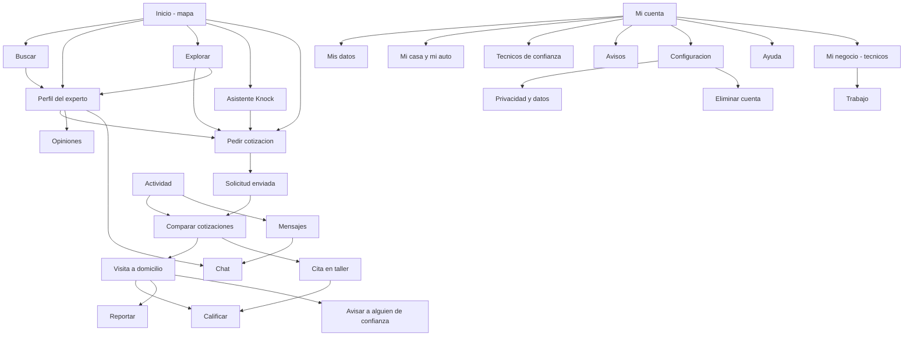

---

## 3. Flujos del cliente

### 3.1 Entrar sin cuenta (explorar)

✅ **En la maqueta**
- La persona puede **ver el mapa, los expertos, sus perfiles, sus precios de referencia y las opiniones sin registrarse**.
- Las acciones que comprometen datos piden entrar con el celular y explican por qué («Para pedir tu cotización, entra con tu celular»): **pedir cotización, escribir a un experto, guardar un técnico de confianza, ver actividad**.
- Tras entrar, **se continúa justo donde se quedó** (por ejemplo, vuelve a la solicitud).

🔧 **En la versión real:** catálogo público de expertos (lectura sin sesión), con paginación y caché; límites de consulta para evitar scraping.

### 3.2 Registro e inicio de sesión

> 🆕 **Decisión del MVP**
> - **Sin contraseña:** solo celular y código SMS. **No existen las HU de contraseña ni de recuperarla.**
> - **Firebase Phone Auth** (con números de prueba en desarrollo y demo): el servidor **valida el token de Firebase y emite sus propios tokens de sesión** (con renovación). Firebase también envía las notificaciones (FCM). ⚠️ Falta confirmar **límites y costo por SMS**.
> - Lo que reemplaza a «recuperar contraseña» es **«Cambiar de número y recuperar el acceso»** (prioridad **Media**; **no existe en la maqueta**, donde el celular no se puede cambiar):
>
> ```mermaid
> flowchart TD
>   A["No tengo acceso a mi numero"] --> B["Cambiar de numero y recuperar acceso"]
>   B --> C["Escribe el numero nuevo y recibe un codigo"]
>   C --> D{"Tipo de cuenta"}
>   D -->|"Tecnico verificado"| E["Repite la selfie y se compara con la ya validada"]
>   D -->|"Cliente"| F["Soporte revisa con datos de sus servicios"]
>   E --> G{"Coincide"}
>   F --> H{"Soporte aprueba"}
>   G -->|"Si"| I["Numero actualizado y sesiones anteriores cerradas"]
>   H -->|"Si"| I
>   G -->|"No"| J["Se rechaza y se ofrece soporte"]
>   H -->|"No"| J
>   I --> K["Aviso al numero anterior"]
> ```


El registro y el inicio de sesión son **el mismo flujo**: «Si es tu primera vez, se crea tu cuenta». Se usa **solo el celular** (sin contraseña) con un **código por SMS**.

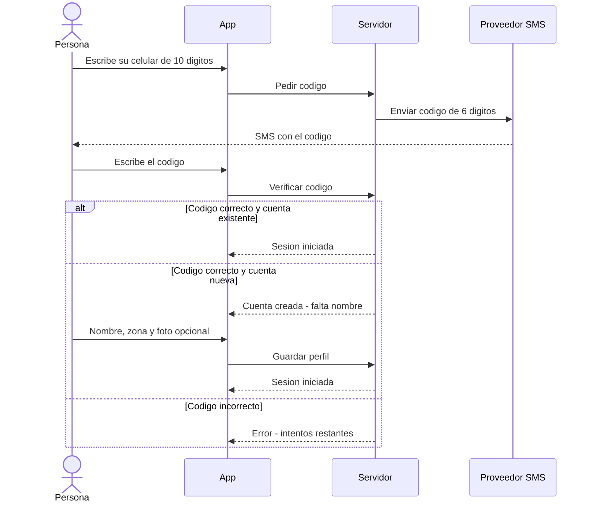

**Pasos en la maqueta**

| # | Paso | Reglas |
|---|---|---|
| 1 | Celular | 10 dígitos, prefijo +52. Se acepta el aviso de privacidad y los términos al continuar. |
| 2 | Código SMS | 6 dígitos. Reenvío con cuenta regresiva. **Demo:** sirve cualquier código de 6 números. |
| 3 | Nombre | Solo si es la primera vez. Mínimo 2 caracteres, solo letras. |
| 4 | Zona | Ver [3.3](#33-zona-ubicación-o-código-postal). Se puede omitir con «Ahora no». |
| 5 | Foto (opcional) | Sin foto se usan las **iniciales** como avatar. La foto se reduce a 320 px. |
| 6 | Listo | «¡Listo, ya entraste!» y se retoma lo que se estaba haciendo. |

> La **dirección ya no se pide al registrarse**: se solicita la primera vez que se pide un servicio a domicilio y queda guardada (ver [3.5](#35-pedir-cotización)).

🔧 **En la versión real**
- **Proveedor de SMS/OTP:** Twilio Verify, AWS SNS/Cognito, Firebase Auth (teléfono), Vonage, MessageBird… (o WhatsApp OTP, que suele salir más barato y entregarse mejor en México).
- **Límites:** máximo de reintentos por código, expiración (5–10 min), bloqueo temporal, límite de envíos por número/IP/dispositivo, detección de números virtuales.
- **Sesión:** tokens de acceso de vida corta + *refresh token*, guardado seguro en el dispositivo, listado y cierre de sesiones por dispositivo (la pantalla «Sesiones y dispositivos» ya existe como maqueta).
- **Unicidad:** un celular = una cuenta. Cambio de número con re-verificación.

### 3.3 Zona (ubicación o código postal)

Se pide **después del nombre** para ubicar a la persona y mostrarle expertos cercanos. Solo se guarda la **colonia** (y el código postal si lo escribió), **nunca las coordenadas**.

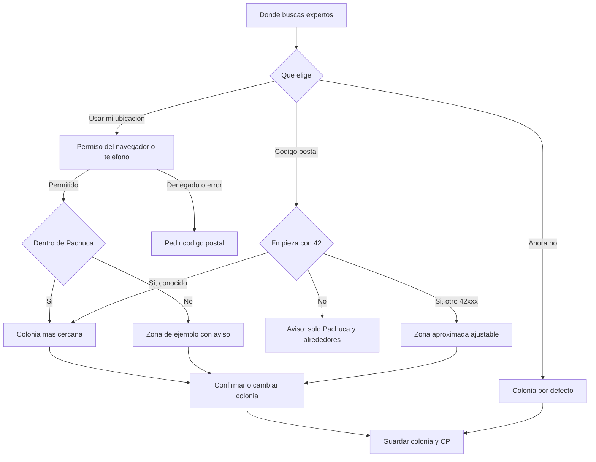

🔧 **En la versión real**
- **Catálogo oficial de códigos postales y colonias** (SEPOMEX / Correos de México) en lugar de la tabla de demostración.
- **Geocodificación inversa** (Google Maps, Mapbox, HERE, Nominatim/OSM) para convertir coordenadas en colonia.
- Política clara: no guardar coordenadas exactas del cliente; solo zona. Para el técnico, solo su **radio de atención**.
- **Cobertura:** lista de ciudades/zonas activas y mensaje de «próximamente» con lista de espera.

### 3.4 Buscar un experto (mapa, búsqueda, asistente)

✅ **En la maqueta**
- **Mapa de Inicio:** pines de expertos con su calificación, punto «tú estás aquí», **arrastrar y zoom** (rueda, pellizco, botones +/−) y botón para volver a tu ubicación.
- **Panel «N expertos cerca de ti»:** tres alturas (colapsado, medio, completo). Colapsado solo muestra el título y una flecha. Incluye acceso a **Explorar**, el selector de **colonia** y la lista.
- **Filtros por categoría:** Todos / Mi auto / Agua y tuberías / Luz y contactos.
- **Búsqueda por texto** («boiler», «frenos»…): detecta la categoría; si no entiende, lo dice y ofrece elegir.
- **Asistente Knock** («No sé cuál»): conversa, pregunta desde cuándo pasa, **exige una foto** y arma la solicitud.
- **Perfil del experto:** presentación, servicios y precios de referencia, opiniones, ¿llega a mi colonia?, horarios, fotos de trabajos, cómo atiende (taller/domicilio) y **si está verificado**.
- **Guardar** como técnico de confianza (requiere cuenta).

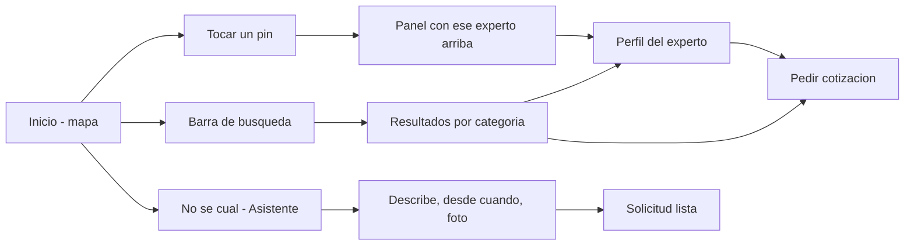

🔧 **En la versión real**
- **Mapa:** Google Maps, Mapbox o MapLibre/OSM (la maqueta usa un mapa SVG ficticio sin internet).
- **Búsqueda geoespacial** (PostGIS o equivalente): expertos por radio de atención y colonia, ordenados por distancia, calificación y disponibilidad.
- **Búsqueda de texto** con sinónimos y errores de ortografía (Elasticsearch/Algolia/Postgres FTS) y, para el asistente, un **modelo de lenguaje** (ver [7.2](#72-proveedores-y-servicios-por-función)).

### 3.5 Pedir cotización

> 🆕 **Decisión del MVP**
> - **Reparto por oleadas:** la solicitud llega a **hasta 5 técnicos con «Disponible hoy» activado** (3 mejor ordenados, 1 nuevo y 1 cercano). Si en **15 min** hay menos de 2 cotizaciones, se **amplía**. El cliente ve **máximo 5** cotizaciones.
> - La solicitud **vence a las 48 h** y el cliente puede **cancelarla**.
> - La solicitud lleva el **día y la franja** preferidos.


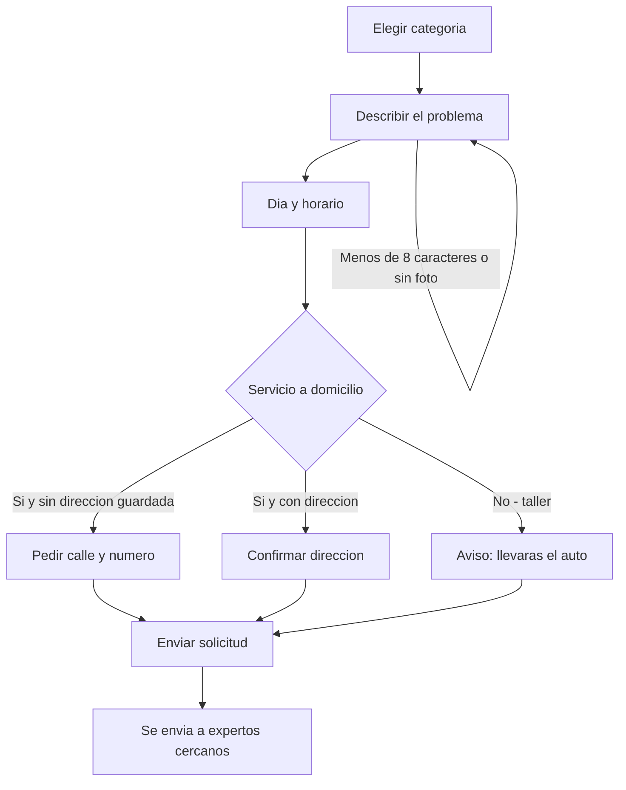

| Paso | Qué se captura | Reglas |
|---|---|---|
| 1. Categoría | Auto / Agua / Luz | Se salta si viene de un servicio popular o del asistente. |
| 2. Qué pasa | Texto (≥ 8 caracteres, máx. 500) y **fotos (mínimo 1, máximo 5)** | La foto es **obligatoria**: le dice al técnico qué herramientas y piezas llevar. JPG/PNG, hasta 8 MB, se reduce a 900 px. Frases sugeridas por categoría. |
| 3. Cuándo y dónde | Día (hoy + 5 días), horario (mañana / tarde / noche) y **dirección** | La dirección solo se pide si es a domicilio y no hay una guardada; se guarda en la cuenta. El técnico solo ve la **colonia** hasta que se acepte su cotización. |

**Después de enviar** ✅ (simulado): hasta **3 técnicos** de la categoría responden, **primero los que llegan a la colonia del cliente**, con retraso escalonado (≈ 4.5 s, 10 s y 15.5 s). Cada respuesta crea una **cotización** (precio fijo o rango, día/hora, nota), un **mensaje**, un **aviso** y un contador de no leídos.

🔧 **En la versión real**
- **Almacenamiento de imágenes:** S3 / Cloudflare R2 / Cloudinary / Firebase Storage con **URLs firmadas**, compresión y generación de miniaturas; eliminar metadatos EXIF (ubicación) y **moderación de contenido** (detección de imágenes inapropiadas).
- **Motor de asignación:** a qué técnicos se envía (categoría, zona/radio, disponibilidad hoy, verificación, calificación, carga) y cuántos como máximo; **expiración** de la solicitud y reenvío.
- **Notificaciones push** al técnico en el momento (clave: «responde en menos de 15 minutos»).
- **IA opcional** para clasificar la categoría y redactar el resumen (ver 4.4).

### 3.6 Comparar, elegir y la visita

> 🆕 **Decisión del MVP**
> - La cotización propone **día y hora**; **al elegirla, la cita queda confirmada**. Hay una HU pequeña (Media) para **reprogramar**.
> - **Chat dentro de la app antes de elegir**, con el número oculto; **después de elegir se abre WhatsApp** (prioridad Alta).
> - La visita con **código de 4 dígitos** (o la cita en el taller con «Cómo llegar») es una **HU propia**.


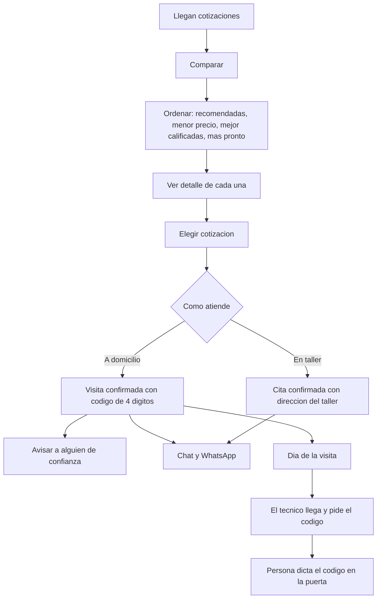

✅ **En la maqueta**
- **Comparar:** tarjetas con foto, calificación, distancia, etiquetas («Mejor precio», «Puede ir más pronto»), **precio fijo o aproximado**, día/hora y la **nota del técnico**. Se puede preguntar antes de elegir (chat).
- **Elegir:** confirma quién va, cuándo y el precio. Al elegir se **revela el teléfono/WhatsApp** y la dirección exacta del taller (o se comparte la del cliente con ese técnico).
- **Visita a domicilio:** se muestra un **código de 4 dígitos aleatorio**. Regla de seguridad: *«Pídele a [técnico] que te diga este código en la puerta. Si no lo sabe, no abras»*. Nunca se dicta por teléfono ni mensaje.
- **Cita en taller:** día, hora, dirección y cómo llegar.
- **Avisar a alguien de confianza:** se elige o **agrega un contacto** y se envía por WhatsApp/SMS el mensaje con quién va, cuándo, la identidad verificada y el código.
- **Más opciones:** ver la conversación, reportar un problema.

🔧 **En la versión real**
- **Números enmascarados / proxy** (Twilio Proxy, Vonage, o WhatsApp Business API) para que el cliente y el técnico se comuniquen sin ver el número real hasta decidirlo.
- **Compartir con un contacto:** envío por WhatsApp/SMS reales (o *deep link* de compartir del sistema operativo).
- **Generación y validación del código en el servidor** (un solo uso, vigencia, intentos limitados) y registro de la **hora real de llegada**.
- **Mapas y rutas:** «Cómo llegar» abre el mapa del dispositivo con la ruta.
- **Recordatorios** automáticos (la víspera y una hora antes).

### 3.7 Terminar, calificar, reportar y bloquear

> 🆕 **Decisión del MVP**
> - El técnico termina con **fotos obligatorias** y la descripción. **No hay confirmación del cliente ni autoconfirmación a las 72 h.** El cliente puede **reportar «no se terminó» hasta 7 días después**.
> - **Reseña:** calificación general **1 a 5 (obligatoria)** y, opcional, **Puntualidad, Calidad, Precio justo y Trato** (1 a 5 cada una); comentario, **hasta 3 fotos**, respuesta del técnico y guardar como «de confianza». Se puede reseñar **hasta 30 días después**. Sale como «Servicio verificado».
> - **Reportes por gravedad:** críticos → suspensión preventiva; altos → se oculta al técnico de nuevas solicitudes; medios → advertencias; bajos → mediación. **La apelación es Media.**


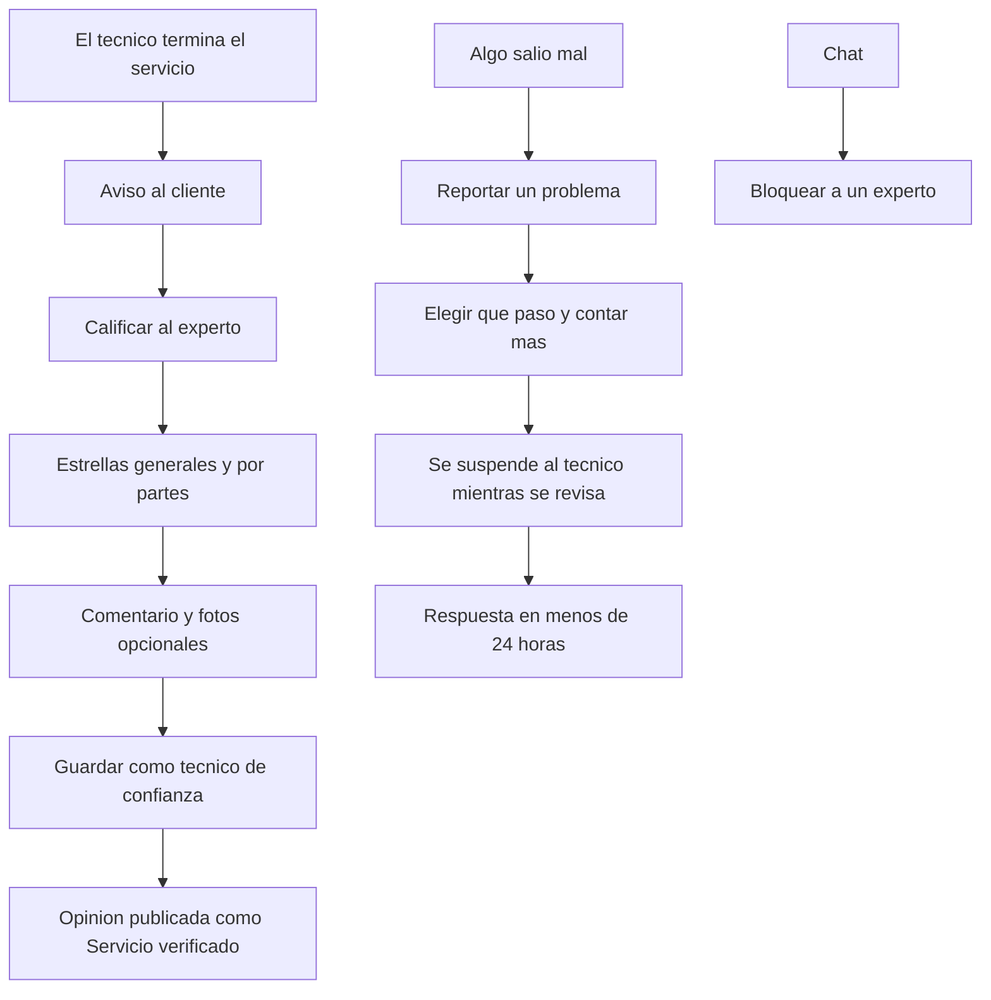

✅ **En la maqueta**
- **Calificar:** calificación general y por partes, comentario, fotos, y opción de **guardar** al técnico en «técnicos de confianza». La opinión sale como **«Servicio verificado»** (porque el trabajo pasó por Knock).
- **Volver a contratar** desde un trabajo terminado o desde «técnicos de confianza».
- **Reportar:** motivos («No se presentó», «Llegó otra persona», «Comportamiento inapropiado», «Cobró distinto a lo acordado», «Otra cosa»), texto y evidencia. Aviso de **llamar al 911** si hay peligro. Se **suspende** la cuenta del reportado mientras se revisa.
- **Bloquear** desde el menú del chat (con «Deshacer»).

🔧 **En la versión real**
- Solo se puede opinar de **trabajos realmente completados** (para que sean «verificados»); moderación de comentarios (insultos, datos personales, spam) y política de réplica del técnico (ya existe «Responder» en reputación).
- **Cola de moderación/soporte** (herramienta interna): casos, evidencias, decisiones, historial, plazos (SLA de 24 h) y notificaciones de resultado a ambas partes.
- **Suspensión automática y apelación**; registro de incidencias por técnico.

### 3.8 Actividad y mensajes

✅ **En la maqueta**
- **Actividad** muestra **todos los servicios en una sola lista**: primero los que siguen en curso y al final los terminados, cada uno con su **etiqueta de estado** («3 cotizaciones listas», «Cita confirmada», «Visita confirmada», «Terminado»…) y una acción principal (Ver y elegir, Ver visita y código, Calificar, Volver a contratar).
- Cada tarjeta incluye el **último mensaje** del experto con su contador de no leídos.
- Los **mensajes** viven en un **globo flotante** (con contador) que abre todas las conversaciones; cada conversación se abre en el chat del experto.
- **Chat:** mensajes, aviso de «no hagas pagos por adelantado», número oculto hasta elegir, menú (ver perfil, bloquear, reportar). Tras elegir una cotización se puede continuar por WhatsApp.

🔧 **En la versión real**
- **Chat en tiempo real:** WebSockets propios o servicios como Firebase/Firestore, Ably, Pusher, Stream o Sendbird; estados de entrega/lectura, adjuntos (fotos) y borradores.
- **Push** de mensajes nuevos (FCM/APNs) y contadores sincronizados entre dispositivos.
- **Filtros de seguridad:** detectar intentos de sacar la conversación de la plataforma o pedir pagos por adelantado y advertir.

### 3.9 Explorar

Pestaña para **mirar sin una necesidad urgente**.

| Bloque | Qué muestra | Al tocar |
|---|---|---|
| **Servicios populares** | Tarjetas de color con «desde $X» (cambio de aceite, boiler, contacto sin corriente, frenos…) | Abre la solicitud con categoría y texto ya llenos |
| **Trabajos reales** | Cuadrícula tipo Pinterest con **fotos de trabajos terminados** por los técnicos | Abre el perfil del técnico |
| **Cerca de ti** / **Mejor calificados** | Filas horizontales de expertos | Abre el perfil |
| **Ideas para tu casa y tu auto** | Consejos de mantenimiento | «Pedir cotización» |

Los **filtros** (Todo / Mi auto / Agua / Luz) afectan a todos los bloques. Las fotos reales vienen de lo que **los técnicos suben obligatoriamente al terminar cada trabajo**; mientras no haya, se usan tarjetas ilustradas.

🔧 **En la versión real:** consentimiento del técnico para mostrar sus fotos y del cliente si aparece su casa/auto (desenfocar placas/rostros), moderación de imágenes y ordenamiento por relevancia y calidad.

### 3.10 Mi cuenta (datos, casa y auto, confianza, avisos, privacidad, ayuda)

| Sección | Qué hace | Estado |
|---|---|---|
| **Mis datos** | Nombre, dirección (opcional), colonia y foto. El celular no se cambia aquí. | ✅ |
| **Mi casa y mi auto** | El cliente registra su auto (marca/modelo y año) y cosas de su casa; el historial del auto sale de sus trabajos reales. | ✅ |
| **Mis técnicos de confianza** | Lista de guardados con «Volver a contratar». | ✅ |
| **Avisos** | Cotizaciones, visitas, solicitudes aceptadas, opiniones. Si es técnico se ven juntos con encabezados «Como cliente» y «Como técnico». | ✅ |
| **Configuración** | Idioma (Español/English), apariencia (claro/oscuro/automático), qué avisos recibir. | ✅ |
| **Privacidad y datos** | Descargar mis datos (en 48 h), corregir, **consentimientos opcionales** (promociones, encuestas, recomendaciones), sesiones y dispositivos. | ✅ |
| **Centro de ayuda** | Preguntas frecuentes por tema (cómo funciona, seguridad, verificación…) y «Hablar con soporte». | ✅ |
| **Legal** | Aviso de privacidad y Términos y condiciones (textos de demostración con campos por completar). | ✅ |

🔧 **En la versión real**
- **Descarga de datos** (derecho de acceso): generar un archivo con todo lo del usuario y enviarlo de forma segura.
- **Corrección** de datos y registro de consentimientos (qué, cuándo y con qué versión del aviso).
- **Chat de soporte** (Intercom, Zendesk, Freshdesk o WhatsApp Business) y base de conocimiento.
- **Textos legales reales** revisados por un abogado.

### 3.11 Cerrar sesión y eliminar cuenta

> 🆕 **Decisión del MVP:** se muestra **lo pendiente**, se ofrece **«Cancelar lo pendiente y eliminar»** con **confirmación por SMS** y **7 días de gracia** (se puede arrepentir). Las **reseñas se anonimizan**, no se borran. Hay que cumplir también lo que piden Apple y Google (eliminar desde la app y, en Google, un enlace web para iniciar la solicitud).


**Cerrar sesión** pide confirmación («Tus trabajos y mensajes se quedan guardados para cuando vuelvas a entrar»).

**Eliminar cuenta** es un flujo de **2 pasos**:

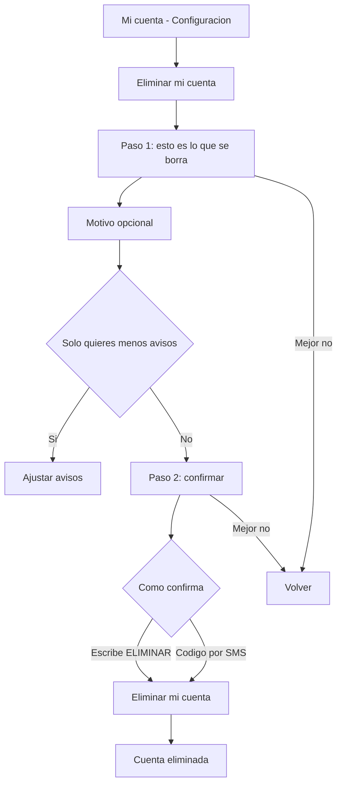

✅ **En la maqueta:** explica qué se borra (perfil y foto, historial de trabajos, mensajes, casa y auto, técnicos de confianza), avisa que **los reportes de seguridad se conservan solo el tiempo que obliga la ley**, pide un motivo opcional, ofrece alternativa («ajusta tus avisos») y exige **escribir ELIMINAR o confirmar con un código por SMS**. Al final «Salir» **reinicia todo** el estado.

🔧 **En la versión real (importante)**

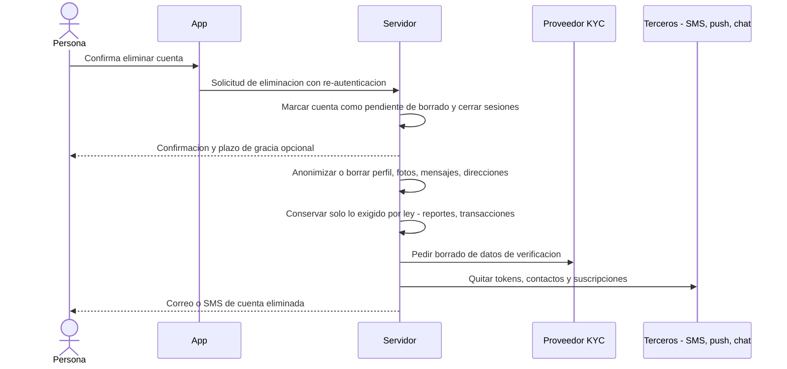

- **Re-autenticación** (código SMS) antes de borrar.
- **Plazo de gracia** opcional (por ejemplo 7–30 días para arrepentirse) y luego **borrado definitivo** + purga de copias de seguridad según calendario.
- **Qué se borra y qué se conserva:** perfil, fotos, mensajes y direcciones se borran o anonimizan; se conserva lo que exija la ley o la seguridad (reportes, registros de fraude) con plazo definido.
- **Efecto en terceros:** pedir al **proveedor de KYC** que borre los datos de verificación, quitar tokens de push, suscripciones y contactos de proveedores.
- **Reglas con trabajos activos:** impedir o resolver antes de borrar (visitas pendientes, cotizaciones abiertas, opiniones publicadas — que normalmente se anonimizan, no se borran).
- **Cuenta de técnico:** además cerrar su perfil público, sus solicitudes y avisar a clientes con citas.
- **Obligatorio en tiendas:** Apple (App Store) y Google Play exigen que se pueda **eliminar la cuenta desde la propia app**.

---

## 4. Flujos del técnico

> Un técnico **sigue siendo un usuario normal**: conserva Inicio, Explorar y Actividad, y puede pedir servicios como cliente.

### 4.1 Registro como técnico

> 🆕 **Decisión del MVP:** **tres oficios** (mecánica, plomería, electricidad) guardados **como datos en una tabla**, no fijos en el código. **«Otro oficio» se guarda como una lista de oficios pedidos** (sirve para decidir qué categoría abrir después). Gestionar categorías es **Media**. Un técnico es **la misma cuenta** que el cliente: gana la pestaña **Trabajo** y la sección **Mi negocio**.


Se entra desde **Mi cuenta → «Ofrece tus servicios en Knock»** (o desde el inicio de sesión: «¿Ofreces servicios?»).

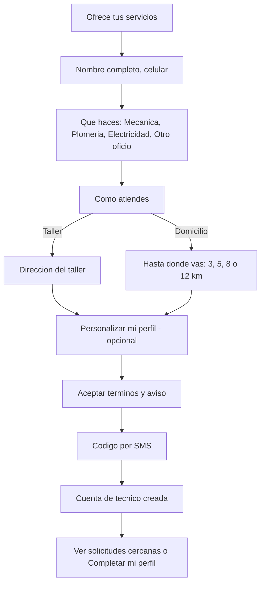

| Campo | Reglas |
|---|---|
| Nombre | Nombre **y apellido**, solo letras. |
| Celular | 10 dígitos. Si ya es cliente, se reutiliza. **Demo:** `771 000 0000` = ya registrado; `771 999 9999` = falla el SMS una vez; código `000000` = incorrecto (3 intentos). |
| ¿Qué haces? | Mecánica, plomería, electricidad **y «Otro oficio»** (texto libre). Alcanza con uno. |
| ¿Cómo atiendes? | Taller (pide dirección, ≥ 8 caracteres) o domicilio (pide radio). La dirección de un técnico a domicilio **no se muestra** a los clientes. |
| **Personalizar mi perfil** *(opcional, plegado)* | Nombre del negocio, años de experiencia (0–60), descripción (≤ 300), servicios con precio de referencia. |
| Términos | Casilla obligatoria. |

> Quien solo elige «Otro oficio» queda registrado y su oficio aparece en su perfil, pero **no recibe solicitudes ni aparece en la búsqueda por categoría**, porque hoy solo existen tres categorías. **Las tres categorías son solo de la maqueta**: el producto real necesita un catálogo administrable (ver [`DECISIONES.md`, punto 0](DECISIONES.md#0-los-oficios-están-limitados-a-tres)).

🔧 **En la versión real:** mismo OTP que el cliente; **verificar que el número no esté ya registrado como técnico**; catálogo de oficios administrable (alta de nuevas categorías con su flujo de cotización y precios de referencia); zonas de cobertura por polígono/radio.

### 4.2 Verificación de identidad (INE + selfie)

> 🆕 **Decisión del MVP: revisión manual**
> - **Una persona del equipo** revisa **INE (frente y reverso) y selfie** desde el **panel interno**. Un proveedor automático (KYC) queda para la versión real.
> - **Las fotos se guardan 30 días, cifradas, con acceso restringido y registro de quién las ve**, y luego se **borran automáticamente**. (Por eso los textos de la maqueta ya no dicen «no guardamos tus fotos»; en la maqueta las fotos solo viven en la pantalla y se descartan al enviar.)
> - **Beneficios:** insignia, filtro «solo verificados» y una ventaja leve en el orden, explicada al usuario.
> - Sigue siendo **opcional** y con **dos niveles**.
>
> ```mermaid
> flowchart TD
>   A["El tecnico envia INE frente, reverso y selfie con consentimiento"] --> B["Fotos guardadas cifradas - maximo 30 dias"]
>   B --> C["Cola de revision en el panel interno"]
>   C --> D["Una persona del equipo revisa - queda registro de quien ve las fotos"]
>   D --> E{"Decision"}
>   E -->|"Aprobada"| F["Verificado - insignia y beneficios"]
>   E -->|"Rechazada"| G["No verificado - motivo y reintento"]
>   E -->|"Dudosa"| H["Se pide otra foto o segunda revision"]
>   F --> I["A los 30 dias se borran las fotos - queda solo el resultado"]
>   G --> I
> ```


La verificación es **opcional**, y el **estado** del técnico varía: *Sin verificar → En revisión → Verificado* (o *No se pudo verificar*). La insignia verde solo la tienen los verificados y el cliente ve «Sin verificar» si no lo está.

**Cuándo se ofrece:** la primera vez que va a **enviar una cotización**, **empezar un trabajo** o **ponerse disponible**, y siempre desde **Mi cuenta → Mi negocio → Verificación de identidad**. Puede elegir «Seguir sin verificar» y la acción se ejecuta.

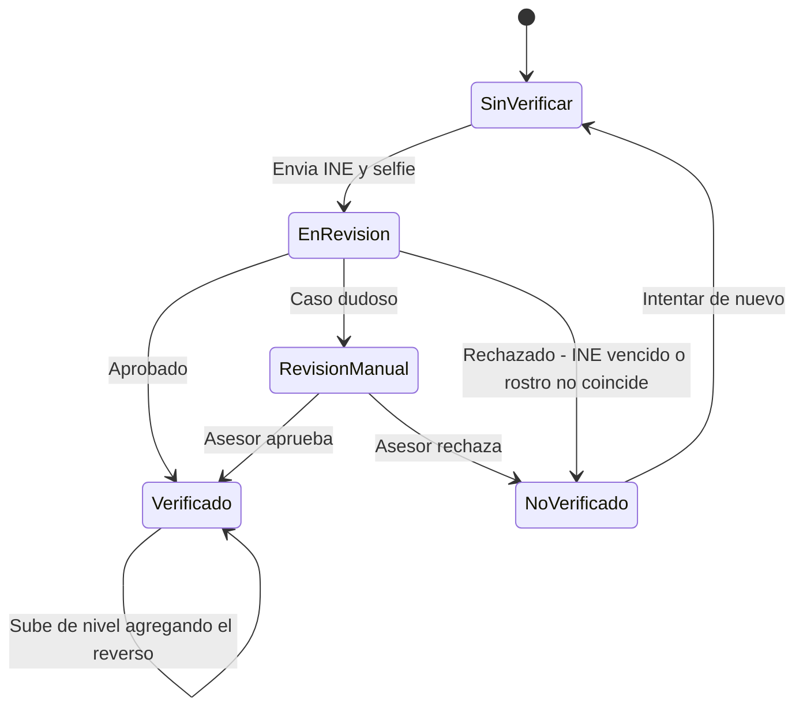

**Niveles**

| Nivel | Qué se pide | Qué se valida |
|---|---|---|
| **Básica** | INE por el **frente** + **selfie** | Que la persona de la selfie coincide con la foto del INE |
| **Completa** | Lo anterior + INE por el **reverso** | Además se validan los datos contra el INE (ver [7.3](#73-verificación-de-identidad-ine-a-fondo)) |

**Captura en la maqueta** ✅
- Cámara del dispositivo (o selector de archivos en computadora) con vista previa y «Repetir».
- **Revisión de la foto en el propio dispositivo:** INE en vertical, imagen muy pequeña, muy oscura, con reflejo/demasiado brillo o **borrosa** (se rechaza con un mensaje claro).
- Las fotos **solo viven en la pantalla**; se descartan al enviar y **no** se guardan en el almacenamiento del navegador.
- Línea de tiempo animada: *Fotos recibidas → Leyendo tu INE → Comparando tu rostro con tu INE → Validando tus datos con el INE* (solo en nivel completo).
- Pantalla de resultado: **verificado** (con opción de subir de nivel), **rechazado** (con la razón y consejos) o **revisión manual** (hasta 24 h).
- **Explicación en lenguaje simple** de qué se hace con los datos y **vista previa del aviso de privacidad** antes de pedir las fotos; consentimiento expreso.
- **Resultado de demostración** según los **dos últimos dígitos del celular**: `…71` INE vencido · `…72` la cara no coincide · `…73` revisión manual (se resuelve a los 16 s) · cualquier otro: aprobado.

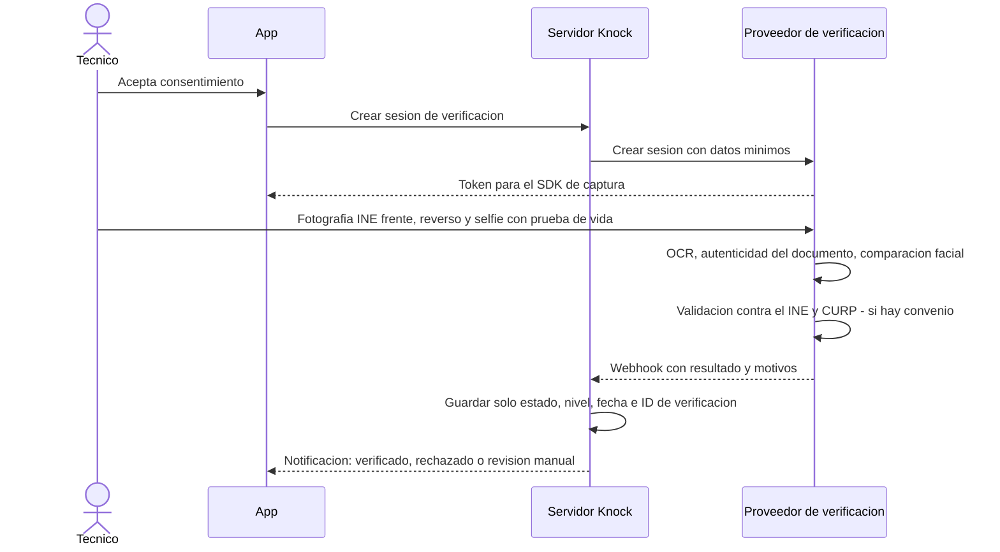

🔧 **Lo que necesita la versión real:** un **proveedor de verificación de identidad (KYC)**. Detalle completo en [7.3](#73-verificación-de-identidad-ine-a-fondo).

### 4.3 Pestaña Trabajo

Reúne en **una sola pantalla** lo que antes eran solicitudes, agenda e inicio del técnico.

| Sección | Contenido |
|---|---|
| **Cabecera** | «Hola, [nombre]», oficios y modo de atención, y el interruptor **«Disponible hoy»** (necesario para recibir solicitudes). |
| **Aviso de verificación** | «Verifica tu identidad (opcional)» o «No pudimos verificar…» según el estado. |
| **Próximas visitas** | Hora, día, cliente, **dirección exacta** (solo tras aceptar), precio y botones **«Cómo llegar»** y **«Ya llegué»**. |
| **Solicitudes nuevas** | Tarjetas con descripción, foto, colonia y cuándo la quiere; **Descartar** o **Chatear y cotizar**. Solo se ve la colonia. |
| **Cotizaciones enviadas** | Con la nota del estado («esperando respuesta»). |
| **Terminadas** | Plegada. |
| **Resumen** | Cotizaciones enviadas / aceptadas / trabajos terminados y **nivel** (ver 4.6). |
| **Globo de mensajes** | Conversaciones con clientes (con contador). |

### 4.4 Chat, resumen con IA y cotización con IA

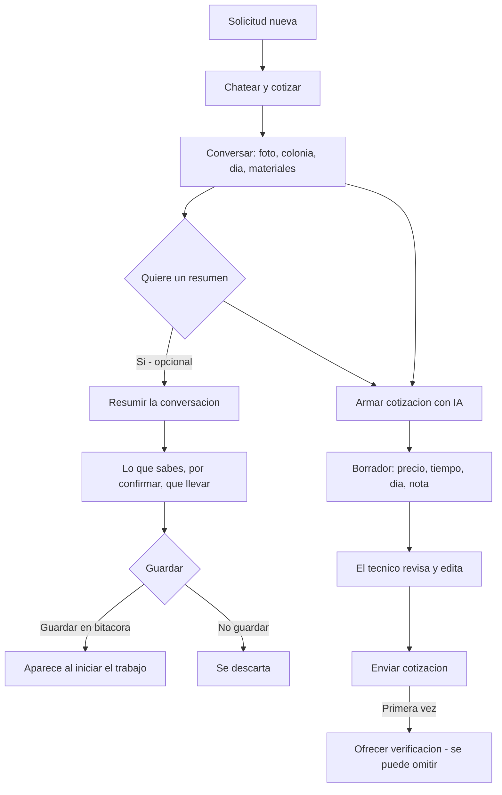

✅ **En la maqueta**
- **Chat con respuestas rápidas** (¿me manda una foto?, ¿cuál es su colonia?, ¿qué día le acomoda?, «llevo los materiales»…) y respuesta simulada del cliente.
- **Resumen con IA (opcional):** «lo que sabes», «por confirmar» y **«qué llevar»** (herramientas según el problema). Se puede **guardar en la bitácora** (aparece al iniciar el trabajo) o descartar.
- **Cotización con IA:** el borrador **cambia según lo conversado** (precio según el tipo de trabajo, recargo por urgencia, margen si lleva materiales, día que pidió el cliente, precio fijo si lo mencionó), muestra **qué tomó en cuenta**, es **editable** («Editada por ti» / «Volver a la sugerencia») y avisa que **la IA puede equivocarse**.

🔧 **En la versión real**
- **Modelo de lenguaje** vía API (por ejemplo la API de Claude u otro proveedor) con: contexto de la solicitud y del chat, **catálogo de precios de referencia** del técnico, salida estructurada (JSON) y **reglas de seguridad** (la IA propone, **el técnico decide y envía**).
- **Privacidad:** no enviar al modelo datos personales innecesarios (teléfono, dirección exacta); registro de qué se mandó; contrato que prohíba entrenar con los datos.
- **Evaluación y límites:** probar con casos reales, límites de tokens/costos por usuario, *fallback* si el servicio falla, y registro de cuánto se edita la sugerencia (para mejorarla).

### 4.5 Aceptación, visita, código y terminar el trabajo

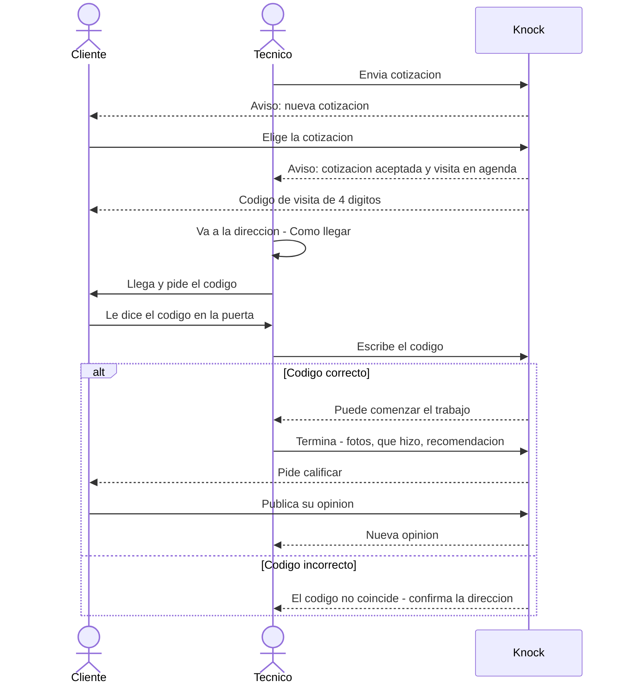

✅ **En la maqueta**
- **Iniciar trabajo** exige el **código de 4 dígitos** (valida y muestra «Código correcto»); si el técnico tiene una **bitácora** guardada, la ve aquí (qué llevar y por confirmar).
- **Terminar servicio:** **fotos del trabajo terminado (mínimo 1, obligatorias y reales)**, «¿qué hiciste?» (obligatorio) y recomendación opcional. Esas fotos pasan al **perfil público** y a **Explorar**.
- Tras terminar, el cliente simulado **califica con 5 estrellas** pocos segundos después.

🔧 **En la versión real:** el código se **valida en el servidor** y deja constancia (hora y ubicación aproximada de llegada); las fotos se suben a almacenamiento con moderación; el cierre dispara la **solicitud de opinión** al cliente (push + correo) y, si hubiera pagos en la plataforma, la liberación del pago.

### 4.6 Reputación y perfil público

✅ **En la maqueta**
- **Perfil público editable:** foto, nombre, negocio, años, oficios, forma de atención, radio, descripción, **servicios y precios de referencia** y **horarios** (abierto/cerrado por día). Se ve en inicio, perfil y búsqueda del cliente.
- **Reputación** calculada con lo que realmente pasó: calificación promedio, distribución por estrellas, opiniones (con **responder**) y **niveles**:

| Nivel | Trabajos terminados |
|---|---|
| Nuevo | 0 |
| Confiable | 1 |
| Experto Knock | 5 |
| Maestro Knock | 15 |

- Insignia verde solo si está **verificado**.

🔧 **En la versión real:** cálculo de reputación en el servidor con reglas anti-manipulación (opiniones solo de trabajos completados, detección de reseñas falsas, pesos por antigüedad), y panel de métricas para el técnico (tasa de respuesta, aceptación, tiempo de respuesta).

### 4.7 Capa «Mi agenda» del mapa

Una **función extra** (no reemplaza la búsqueda de expertos): en Inicio, los técnicos ven un chip **«Mi agenda»**. Al activarlo, el mapa se **encuadra** sobre sus **visitas** (pin naranja con la hora) y **solicitudes nuevas** (pin blanco con borde), y el panel muestra la **tarjeta de cada visita con su dirección**, «Cómo llegar» y «Ya llegué». Los pines de la agenda solo marcan la **zona aproximada**; la dirección exacta está en la tarjeta.

🔧 **En la versión real:** ubicación real de cada visita (geocodificación de la dirección), **ruta y orden sugerido** de visitas del día y tiempos de traslado (APIs de rutas).

---

## 5. Estados de las entidades

**Solicitud del cliente (vista del cliente)**

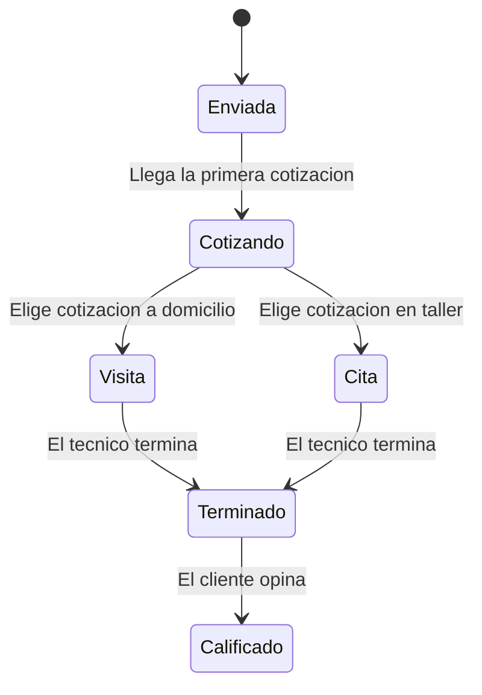

**Solicitud (vista del técnico)**

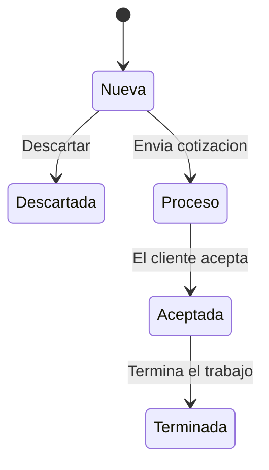

**Verificación:** ver el diagrama de la sección [4.2](#42-verificación-de-identidad-ine--selfie).

---

## 6. Modelo de datos (conceptual)

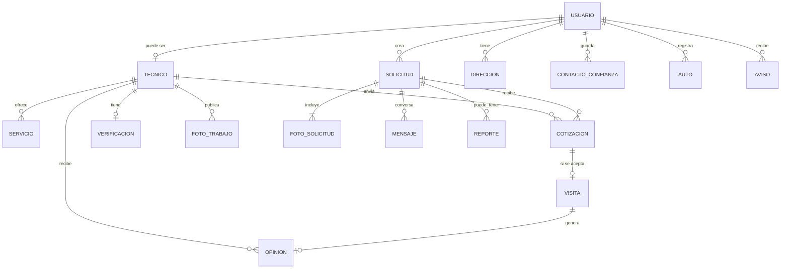

| Entidad | Campos principales |
|---|---|
| **Usuario** | id, celular (único), nombre, foto, colonia, código postal, consentimientos, fecha de alta, estado |
| **Dirección** | usuario, calle y número, colonia, referencias (cifrada) |
| **Técnico** | usuario, negocio, oficios (+ otro), taller o domicilio, radio, dirección del taller, años, descripción, horarios, disponibilidad, estado de verificación, nivel |
| **Servicio** | técnico, nombre, detalle, precio de referencia |
| **Solicitud** | cliente, categoría, descripción, día/horario preferidos, dirección o colonia, estado, expiración |
| **Cotización** | solicitud, técnico, tipo (fijo/rango), precio, día/hora, tiempo estimado, nota, estado |
| **Visita** | cotización, código (hash, un uso), hora de llegada, estado, fotos y resumen al terminar |
| **Mensaje** | conversación, remitente, texto/adjunto, leído |
| **Opinión** | visita, estrellas generales y por partes, texto, fotos, respuesta del técnico |
| **Verificación** | técnico, proveedor, ID de sesión, estado, nivel, motivos, fechas (**sin guardar las fotos**) |
| **Reporte** | solicitud/visita, quién reporta, motivo, evidencia, decisión, fechas |
| **Aviso** | usuario, tipo, texto, destino, leído |

---

## 7. Qué necesita la versión real

### 7.1 Arquitectura general

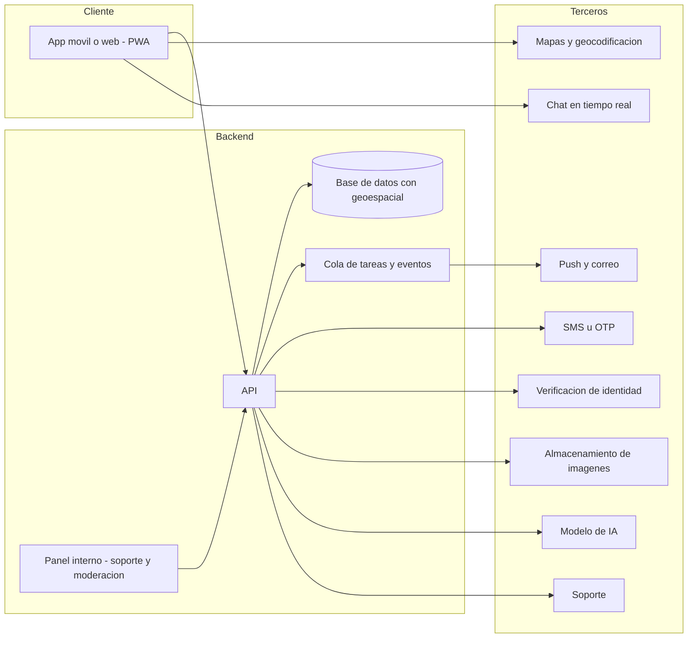

### 7.2 Proveedores y servicios por función

> 🆕 **Decisión del MVP: la pila elegida**
>
> | Pieza | Elegido |
> |---|---|
> | App | **Flutter** (la maqueta es solo la especificación visual) |
> | Panel interno | **Flutter web** |
> | Backend | **ASP.NET Core + GraphQL** |
> | Base de datos | **PostgreSQL + PostGIS** |
> | Chat en tiempo real | **Suscripciones de GraphQL** + servicio que reparte mensajes entre instancias; **notificación** si la otra persona no está conectada |
> | Código SMS y notificaciones | **Firebase Phone Auth** (números de prueba en dev/demo) y **FCM**; el servidor emite sus propios tokens de sesión |
> | Mapa | **Google Maps para Flutter** |
> | Colonia / zona | **Tabla propia de colonias de Pachuca** (catálogo SEPOMEX + PostGIS), sin geocodificación pagada |
> | IA | **Azure OpenAI** |
> | Archivos privados | Almacenamiento de **Azure** con **enlaces temporales** |
> | ML | **ML.NET** (orden «Recomendadas» y rango de precio de referencia) |
> | Verificación | **Revisión manual** en el MVP; KYC automático en la versión real |
>
> ⚠️ Pendiente: **costo y límites de Firebase SMS** y **precio actual de Google Maps**. La tabla de abajo es el panorama general de opciones de mercado.


> Los nombres son **ejemplos habituales**, no una recomendación cerrada. **Los costos cambian y dependen de volumen**: hay que cotizar con cada proveedor antes de decidir.

| Función | Qué se necesita | Opciones comunes |
|---|---|---|
| **Backend y base de datos** | API, base relacional con soporte geoespacial, autenticación, colas | Node/Python/Go + PostgreSQL + PostGIS; o plataformas como Supabase / Firebase |
| **Hosting** | Servidores, HTTPS, escalado, copias de seguridad | Railway, Render, Fly.io, AWS, Google Cloud, Azure |
| **Inicio de sesión (OTP)** | SMS o WhatsApp con código, límites y antifraude | Twilio Verify, AWS SNS/Cognito, Firebase Auth, Vonage, MessageBird |
| **Verificación de identidad (INE)** | Captura, OCR, autenticidad, prueba de vida, comparación facial, validación INE/CURP | Truora, Metamap, Veriff, Incode, Nufi, Sumsub, Onfido (ver 7.3) |
| **Mapas y ubicación** | Mapa interactivo, geocodificación, rutas, autocompletado de colonias | Google Maps Platform, Mapbox, HERE, MapLibre/OpenStreetMap + Nominatim |
| **Códigos postales** | Catálogo oficial CP–colonia–municipio | SEPOMEX / Correos de México (descarga oficial) |
| **Fotos** | Almacenamiento, miniaturas, URLs firmadas, moderación | S3, Cloudflare R2, Cloudinary, Firebase Storage + moderación (AWS Rekognition, Google Vision) |
| **Chat** | Mensajería en tiempo real, adjuntos, lectura | Firebase, Ably, Pusher, Stream, Sendbird, o WebSockets propios |
| **Números enmascarados / contacto** | Hablar sin mostrar el número real | Twilio Proxy/Conversations, Vonage, WhatsApp Business API |
| **Notificaciones push** | Móvil y web | Firebase Cloud Messaging, APNs, OneSignal |
| **Correo transaccional** | Confirmaciones, recibos, avisos | SendGrid, Amazon SES, Postmark, Resend |
| **IA (resumen y cotización)** | Modelo con salida estructurada y control de datos | API de un modelo de lenguaje (por ejemplo la API de Claude) con reglas y *fallback* |
| **Soporte** | Chat y tickets, base de conocimiento | Intercom, Zendesk, Freshdesk, WhatsApp Business |
| **Panel interno** | Moderación, reportes, verificaciones manuales, métricas | Construido a medida o con herramientas de *back office* |
| **Analítica y errores** | Embudos, errores, rendimiento | Mixpanel/Amplitude/PostHog, Sentry, Datadog |
| **Pagos (si se agregan)** | Cobro en plataforma, comisiones, reembolsos | Mercado Pago, Stripe, Conekta, OpenPay — hoy **no hay pagos**: se acuerda directo y se avisa «no hagas pagos por adelantado» |
| **Apps móviles** | Empaquetar la app | PWA, o React Native / Flutter / nativo; publicación en App Store y Google Play |

### 7.3 Verificación de identidad (INE) a fondo

> 🆕 **Decisión del MVP:** esta sección describe cómo sería **con un proveedor KYC (versión real)**. En el MVP la verificación la hace **una persona del equipo** y las fotos se guardan **30 días, cifradas** (ver 4.2). Cuando se integre un proveedor, esos 30 días y el texto de privacidad deberán revisarse con el abogado.


**La pregunta clave:** *¿hace falta un proveedor que lo valide?* **Sí.** La maqueta solo **simula** el resultado; nadie puede validar un INE «a mano» ni construir sin riesgo la comparación facial y la validación contra el padrón. Se contrata un **proveedor de verificación de identidad (KYC)**.

**Qué hace un proveedor típico**

| Capacidad | Para qué sirve |
|---|---|
| **Captura guiada** (SDK web/móvil) | Ayuda a tomar INE y selfie con buena luz, enfoque y encuadre (menos rechazos) |
| **OCR** | Lee nombre, CURP, fecha de nacimiento, vigencia, número de credencial |
| **Autenticidad del documento** | Detecta fotocopias, pantallas, recortes y alteraciones; lee QR y código de barras del reverso |
| **Prueba de vida (liveness)** | Comprueba que hay una persona real y no una foto o video |
| **Comparación facial** | Compara la selfie con la foto del INE |
| **Validación contra el INE** | Con los datos del **reverso** (CIC, identificador ciudadano, número OCR) consulta si la credencial es **vigente y válida** en el padrón/lista nominal. *Requiere que el proveedor tenga la integración o convenio correspondiente.* |
| **Validación de CURP** | Consulta contra RENAPO que el CURP existe y coincide con el nombre |
| **Revisión manual** | Cola con analistas para casos dudosos |
| **Webhooks y reportes** | Resultado, motivos de rechazo, métricas |

**Por eso el reverso importa:** el **frente** sirve para la cara, el nombre y la CURP; el **reverso** trae los datos con los que se valida la credencial contra el INE y ayuda a detectar falsificaciones. De ahí los dos niveles de la maqueta (**básica** = frente + selfie, **completa** = + reverso).

**Cómo se integra**

1. El servidor crea una **sesión de verificación** con el proveedor (con datos mínimos: nombre registrado, referencia interna).
2. La app abre el **SDK** del proveedor (o un flujo web) para capturar las fotos; **las imágenes no pasan por tu servidor** si el contrato lo permite.
3. El proveedor responde por **webhook** con *aprobado / rechazado / revisión manual* y **motivos**.
4. Knock guarda **solo el resultado**: estado, nivel, fecha, ID de la verificación y códigos de motivo. Nunca las fotos.
5. Reglas extra: **el nombre del INE debe coincidir con el del registro**; **un mismo CURP no puede estar en dos cuentas**; **re-verificación** periódica o ante cambios sensibles; reintentos limitados.

**Casos de rechazo que ya muestra la maqueta:** INE vencido, rostro que no coincide, foto borrosa/oscura/con reflejo, INE en vertical, y **revisión manual**.

**Qué decidir antes de contratar**
- Qué validaciones **incluye realmente** cada proveedor (¿validan contra el INE? ¿CURP? ¿liveness activo o pasivo?).
- **Costo por verificación** y mínimos mensuales (cotizar; varía por proveedor y volumen).
- **Retención de imágenes y datos:** cuánto tiempo guardan las fotos, dónde (país/región) y si pueden **borrarlas bajo demanda**. *El texto de «no guardamos tus fotos» de la maqueta solo es cierto si el contrato lo permite.*
- **Tasa de aprobación** en credenciales mexicanas y experiencia en celulares de gama baja.
- **Accesibilidad e idioma** del flujo y soporte en español.
- **Cumplimiento:** contrato de **encargado de tratamiento de datos**, ubicación de los servidores y certificaciones de seguridad.

### 7.4 Legal, privacidad y tiendas de apps

> Esto es una **lista de puntos a revisar con un abogado**, no asesoría legal.

- **Aviso de privacidad integral** (la maqueta trae un texto de demostración con campos por completar: razón social, domicilio, correo de privacidad). Debe describir **finalidades necesarias y voluntarias**, transferencias y derechos **ARCO**.
- **Datos sensibles/biométricos:** la selfie con prueba de vida y la comparación facial son **datos biométricos**; requieren **consentimiento expreso** y medidas reforzadas. El INE contiene datos personales y de identificación.
- **Consentimientos separados** y revocables (promociones, encuestas, recomendaciones) con registro de fecha y versión.
- **Derechos ARCO:** acceso (descarga de datos), rectificación, cancelación (eliminar cuenta) y oposición, con plazos de respuesta.
- **Retención y borrado:** definir plazos por tipo de dato y qué se conserva por obligación legal.
- **Términos y condiciones:** rol de Knock como **intermediario** (no presta el servicio), responsabilidad, reglas de conducta, política de suspensión y de reportes.
- **Tiendas de apps:** Apple y Google exigen **política de privacidad**, declaración de datos recopilados y **eliminación de cuenta desde la app**.
- **Menores de edad:** validar mayoría de edad en el registro de técnicos (el INE lo permite).
- **Fiscal y laboral** (cuando haya pagos o comisiones): comprobantes, retenciones y la relación con los técnicos (independientes).

### 7.5 Seguridad y antifraude

- **Cifrado** en tránsito (HTTPS) y en reposo; **direcciones** y datos sensibles cifrados a nivel de campo; mínimo privilegio y registros de acceso.
- **Anti-abuso en el OTP:** límites, detección de SIM/VoIP, bloqueo por dispositivo.
- **Código de visita:** de un solo uso, con vencimiento, verificado en el servidor.
- **Protección de la conversación:** números enmascarados y advertencias ante intentos de pagos por adelantado o de mover el trato fuera de Knock.
- **Reputación y reseñas:** solo de trabajos completados; detección de patrones sospechosos.
- **Moderación** de fotos y textos; **reportes** con suspensión preventiva y apelación.
- **Respaldo y recuperación**, monitoreo y alertas, y pruebas de seguridad antes de salir.

---

## 8. Qué es simulado en la maqueta

| Función | Cómo funciona hoy | Qué lo reemplazaría |
|---|---|---|
| Datos y cuentas | Se guardan en el **navegador** (`localStorage`); no hay servidor | Backend + base de datos |
| SMS | Sirve **cualquier código de 6 dígitos** (`000000` = incorrecto) | Proveedor de SMS/OTP |
| Zona por ubicación | Convierte coordenadas a la colonia más cercana de **una tabla fija** y descarta las coordenadas | Geocodificación inversa + catálogo de colonias |
| Códigos postales | Tabla de **4 códigos** de demostración | Catálogo oficial SEPOMEX |
| Mapa | **Ciudad ficticia dibujada en SVG** | Mapa real (Google/Mapbox/OSM) |
| Expertos | Lista fija de ejemplo + el técnico que se registre en el mismo navegador | Base de datos de técnicos reales |
| Cotizaciones del cliente | Hasta 3 técnicos de ejemplo responden con retraso y precios por reglas | Técnicos reales respondiendo |
| Aceptación del cliente (lado técnico) | El cliente simulado acepta ≈ 9 s después de recibir la cotización | Clientes reales |
| Opinión tras terminar | Llega sola ≈ 4 s después (5 estrellas) | Opinión real del cliente |
| Verificación INE | Captura real de fotos y **revisión de calidad en el dispositivo**, pero el **resultado lo decide la terminación del celular** | Proveedor KYC |
| IA (resumen y cotización) | **Reglas locales** (palabras clave y precios por tipo de trabajo) | Modelo de lenguaje vía API |
| Chat | Respuestas automáticas simuladas | Mensajería en tiempo real |
| «Cómo llegar», WhatsApp, soporte | Muestran un aviso («Abriendo el mapa…») | Integraciones reales |
| Descarga/corrección de datos, sesiones | Solo avisos de confirmación | Procesos reales |
| Eliminar cuenta | **Reinicia el estado local** | Borrado real con reglas de retención |
| Notificaciones | Avisos dentro de la app | Push, correo y SMS |

---

> 🆕 **Texto de verificación:** la maqueta ya dice lo decidido para el producto (fotos guardadas cifradas 30 días y revisadas por una persona del equipo), aunque la maqueta en sí descarta las fotos al enviar.

## 9. Cómo probar la maqueta (datos y atajos de demo)

**Servidor local:** `python -m http.server 8080` (o `npm start`) y abrir <http://localhost:8080/>.

**Zona de pruebas:** botón **Pruebas** (arriba). Las pruebas guiadas y los atajos corren en un **espacio aislado** que no toca los datos guardados; «Borrar todo y reiniciar» limpia todo.

| Qué probar | Cómo |
|---|---|
| Registro de cliente | **Entrar** → cualquier celular de 10 dígitos → cualquier código de 6 → nombre → zona → foto |
| Zona por código postal | `42000` Centro · `42030` Los Pinos · `42080` Las Palmas · `42090` Jardines · otro `42xxx` zona aproximada · otro prefijo = fuera de cobertura |
| Registro de técnico | Mi cuenta → «Ofrece tus servicios». Celular `771 000 0000` = ya registrado · `771 999 9999` = falla el SMS una vez · código `000000` = incorrecto |
| Verificación | Termina en `71` INE vencido · `72` rostro no coincide · `73` revisión manual · otro: aprobado. Imágenes borrosas, oscuras o INE vertical se rechazan |
| Ciclo completo | Pedir cotización (con foto) → comparar → elegir → (como técnico) Trabajo → «Ya llegué» → código → terminar con foto → opinión |
| Datos de ejemplo | Pruebas → atajo **«Cliente con historial de ejemplo»** |
| Técnico de ejemplo | Pruebas → «Técnico registrado» / «Técnico verificado» |

---

## 10. Decisiones y pendientes

Las decisiones de producto, técnicas y de negocio **ya están cerradas**: ver [`DECISIONES.md`](DECISIONES.md#-decisiones-cerradas-octubre-2026) (24 puntos). Quedan **pendientes**:

1. **Costo y límites de Firebase Phone Auth** (SMS) antes de la demo.
2. **Precio actual de Google Maps** para Flutter.
3. **Revisión legal** del aviso de privacidad y del consentimiento de verificación (**conservación de 30 días de datos biométricos**).
4. **Capacidad del equipo** para revisar verificaciones y reportes (horarios y plazos).
5. **Política de retención** completa y borrado automático de fotos.
6. **Paquetes de Flutter** para la captura de INE/selfie y para el mapa con capas.
